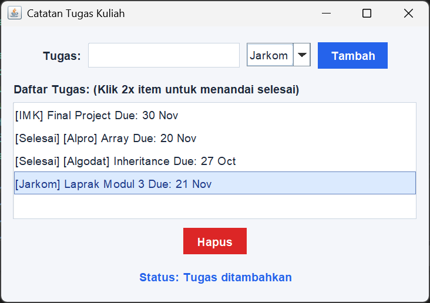

# GUITask — Java Swing GUI Application

Aplikasi desktop berbasis Java Swing dan AWT untuk mencatat tugas kuliah harian berdasarkan mata kuliah (`Alpro`, `Algodat`, `Jarkom`, `IMK`), menandai tugas yang sudah selesai dengan klik ganda, serta menghapus item tugas yang dipilih dengan antarmuka yang rapi dan berwarna.

## Fitur Utama
- **Manajemen Daftar Tugas**: Tambah tugas baru sesuai mata kuliah (`Alpro`, `Algodat`, `Jarkom`, `IMK`) menggunakan tombol **Tambah** berwarna biru dan hapus tugas yang dipilih menggunakan tombol **Hapus** berwarna merah.
- **Tandai Selesai Cepat**: Klik ganda (*double-click*) pada item di `daftarTugas` untuk menambahkan awalan `[Selesai]` dan mengubah warna status menjadi hijau.
- **Pintasan Keyboard**: Tekan tombol **Enter** pada `inputTugas` untuk langsung menambahkan tugas.
- **Status & Tema Berwarna**: Menggunakan palet warna khusus (`WARNA_BG`, `WARNA_BIRU`, `WARNA_MERAH`, `WARNA_HIJAU`), *font* `SansSerif`, *padding* (`EmptyBorder`), serta garis bingkai (`LineBorder`).

## 5 GUI Components / Parts dalam Kode
1. **Top-Level Container Class (`JFrame` pada `Main`)**
   - Kelas `Main` mewarisi `JFrame` sebagai jendela utama aplikasi berukuran `500x350` dengan judul `"Catatan Tugas Kuliah"`, posisi tengah layar (`setLocationRelativeTo(null)`), dan `JFrame.EXIT_ON_CLOSE`.
2. **Intermediate Container Class (`JPanel` & `JScrollPane`)**
   - `rootPanel` (sebagai *content pane* dengan `EmptyBorder`), `panelAtas`, `panelTengah`, `panelBawah`, dan `panelTombol` (`JPanel`) mengelompokkan komponen serta mengatur warna latar; `scrollDaftar` (`JScrollPane` dengan `LineBorder`) membungkus `daftarTugas` agar daftar dapat di-scroll.
3. **Atomic Component Class (`JLabel`, `JTextField`, `JComboBox`, `JButton`, `JList`)**
   - Komponen antarmuka dasar meliputi `labelTugas`, `labelDaftar`, dan `labelStatus` (`JLabel`), `inputTugas` (`JTextField`), `pilihMatkul` (`JComboBox` berisi `"Alpro"`, `"Algodat"`, `"Jarkom"`, `"IMK"`), `tombolTambah` dan `tombolHapus` (`JButton`), serta `daftarTugas` (`JList` dengan `DefaultListModel`).
4. **Layout Classes (`BorderLayout`, `FlowLayout`, & `GridLayout`)**
   - `BorderLayout` mengatur tata letak utama (`NORTH`, `CENTER`, `SOUTH`) pada `rootPanel` dan `panelTengah`; `FlowLayout` menyusun elemen secara mendatar pada `panelAtas` dan `panelTombol`; `GridLayout` (`2x1`) menyusun `panelTombol` dan `labelStatus` pada `panelBawah`.
5. **Event Listener (`ActionListener`, `KeyAdapter`, & `MouseAdapter`)**
   - `ActionListener` (override `actionPerformed`) menangani klik `tombolTambah` dan `tombolHapus`; `KeyAdapter` (override `keyPressed`) menangkap tombol `Enter` (`KeyEvent.VK_ENTER`) pada `inputTugas`; `MouseAdapter` (override `mouseClicked`) mendeteksi klik ganda (`e.getClickCount() == 2`) pada `daftarTugas`.

## Screenshot Aplikasi

## Cara Menjalankan
1. Compile file Java: `javac Main.java`
2. Jalankan program: `java Main`
